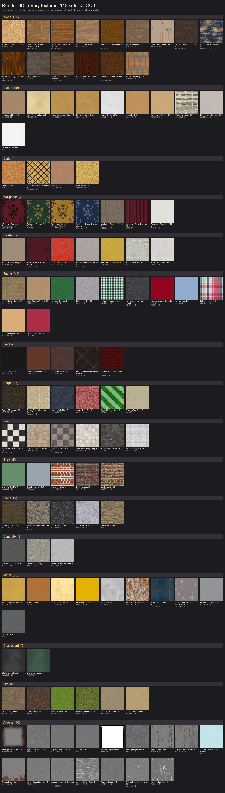

# Render 3D Library

Free 3D characters, animations, props, textures and decals used to build short 3D videos in Blender and in three.js inside Remotion. Every file here is CC0 (public domain): free for personal and commercial use, no credit required. Each folder keeps the original licence file.

## Contents

| Folder | What it holds | Models | Creator | Licence |
|---|---|---|---|---|
| Animations/KayKitCharacterAnimations | 131 human animation clips in 8 sets (movement, general, simulation, tools, combat, special) on the Rig_Medium skeleton | 8 files | Kay Lousberg (KayKit) | CC0 |
| Characters/KayKitMannequin | Rigged neutral mannequin that plays every clip above | 1 | Kay Lousberg (KayKit) | CC0 |
| Characters/KayKitAdventurers | Barbarian, Knight, Mage, Rogue, Rogue Hooded | 5 | Kay Lousberg (KayKit) | CC0 |
| Characters/RobotExpressive | Robot with 14 clips (walk, run, wave, jump, dance, thumbs up and more) | 1 | Tomas Laulhe, modified by Don McCurdy | CC0 |
| Characters/KenneyPlatformer | Small robot character and platform props, with textures | 15 | Kenney | CC0 |
| Props/KayKitCityBuilder | Roads, buildings, cars, street props | 41 | Kay Lousberg (KayKit) | CC0 |
| Props/KayKitFurniture | Room and home furniture | 53 | Kay Lousberg (KayKit) | CC0 |
| Props/KayKitRestaurant | Kitchen, food and restaurant props | 144 | Kay Lousberg (KayKit) | CC0 |
| Props/KayKitAdventurersProps | Mugs, books, shields, tools and weapons | 27 | Kay Lousberg (KayKit) | CC0 |
| Props/KenneyCityBuilder | Roads and buildings | 15 | Kenney | CC0 |
| Props/KenneyNatureKit | Trees, plants, flowers, rocks, crops, paths, bridges and camp props | 329 | Kenney | CC0 |
| Props/KenneyFantasyTown | Town walls, roofs, stalls, carts, banners, lanterns, fences and a windmill, with one shared texture | 167 | Kenney | CC0 |

## Textures and decals

Added 7 Nov 2026 for the cartoon shorts (flat 2D characters in a 3D world): 118 seamless texture sets in 16 families and 23 decals, 130 MB in all. [Catalogue.json](Catalogue.json) lists every one with its id, family, what it suits, maps, resolution, file sizes, median colour, real tile size in metres, source and licence.



All decals are on one sheet too: [Decals/Decal.Swatches.png](Decals/Decal.Swatches.png).

| Folder | What it holds | Sets | Sources | Licence |
|---|---|---|---|---|
| Textures/Wood | Light, medium and dark worn floor planks, herringbone parquet, oak, walnut, mahogany and knotty pine grain, a worn plank table top, dark worn panelling, dark and rough nailed planks, chipboard, navy painted wood, wicker | 15 | ambientCG, Poly Haven | CC0 |
| Textures/Paper | Plain white and recycled, crumpled white, aged beige (2K), aged and yellowed, newsprint, kraft, crumpled kraft, clean and torn cardboard | 10 | ambientCG, made here | CC0 |
| Textures/Cork | Yellow cork (2K), the same cork with dark brown criss cross ribbons and brass tacks for a bulletin board (2K), amber cork (2K), tan cork | 4 | ambientCG, made here | CC0 |
| Textures/Wallpaper | Dark burgundy damask with a near black print for closed rooms (2K), the same damask in green and gold, navy and grey, mustard and brown, a burgundy regency stripe, white woodchip, decrepit peeling paper | 7 | made here, ambientCG, Poly Haven | CC0 |
| Textures/Plaster | White stucco, old white with light grime, painted beige, yellow, red and weathered, dark burgundy with grime | 7 | ambientCG, Poly Haven, made here | CC0 |
| Textures/Fabric | Grey and green felt, red velvet, blue linen, canvas, coarse burlap, red quatrefoil and dark floral jacquard, gold satin, green gingham, red plaid | 11 | Poly Haven, ambientCG, made here | CC0 |
| Textures/Leather | Burgundy tufted chesterfield, dark brown, worn brown, black, dark diamond stitched | 5 | ambientCG | CC0 |
| Textures/Carpet | Beige wool, plain red, plain navy, beige squares, green stripes, dirty green | 6 | ambientCG, Poly Haven | CC0 |
| Textures/Tiles | Black and white checker, cream checker, dark marble checker, white subway, dirty beige and old dark stone tiles, all with grout | 6 | ambientCG, Poly Haven | CC0 |
| Textures/Brick | Clean, old and dark red brick, white and mint painted brick | 5 | ambientCG, Poly Haven | CC0 |
| Textures/Stone | Cobblestones in arches, castle blocks, rustic stone wall, white and black marble | 5 | ambientCG, Poly Haven | CC0 |
| Textures/Concrete | Smooth light, old grey, worn floor | 3 | ambientCG, Poly Haven | CC0 |
| Textures/Metal | Polished and aged gold, polished brass, copper, iron, rusted iron, scratched and brushed steel, red and blue painted metal | 10 | ambientCG, Poly Haven, made here | CC0 |
| Textures/Chalkboard | Green and black chalkboards with wiped chalk dust | 2 | made here | CC0 |
| Textures/Ground | Lawn and lush grass, soil and path dirt, yellow and beach sand | 6 | ambientCG | CC0 |
| Textures/Ageing | Overlays: light and heavy dust, coffee rings, water stains, smudges, dirt grunge, random and fine scratches, fingerprints, smear wipes, leak streaks and drips, rust along an edge; cracked white paint; two whole surface masks for corner grime and worn, torn edges | 16 | ambientCG, made here | CC0 |
| Decals/Pins | Red, blue, green, yellow and white push pins and a brass thumbtack | 6 | made here | CC0 |
| Decals/Notes | Sticky notes in yellow, pink, blue and green, an index card, a torn notebook page | 6 | made here | CC0 |
| Decals/Posters | Blank aged posters: one with a printed border, one torn with folds | 2 | made here | CC0 |
| Decals/Frames | Gilt and dark wood picture frames with a transparent centre | 2 | made here | CC0 |
| Decals/Tape | Masking, brown packaging, silver duct and yellow caution tape strips | 4 | ambientCG | CC0 |
| Decals/Atlases | Torn cardboard pieces, graffiti tags, a modern painting | 3 | ambientCG | CC0 |

### File names and maps

* Every texture file is named `<Id>.<Map>.<Res>.jpg`, for example `Wood.Floor.Planks.Light.01.Color.2K.jpg`. 1K is 1024 pixels wide; 2K (six hero surfaces only) is 2048.
* Maps: Color (sRGB), Normal (OpenGL style, green up, right for three.js and Blender as it is), Roughness, AO, Metalness and Opacity (white shows, black is clear). Displacement and DirectX normal maps were left out.
* Every set tiles with no seam. Catalogue.json gives `tileMetres`, the real width of one tile (and `tileHeightMetres`), so any wall keeps the right scale: repeat = surface size divided by tile size.
* Downloaded maps were saved again as JPEG quality 90 to keep the library small; at video size they look the same.

### three.js

Inside Remotion, copy the sets a film uses into its public folder and load them with `staticFile`, the same way the films load props.

```js
import * as THREE from "three";

const loader = new THREE.TextureLoader();
const base = "Textures/Wallpaper/Wallpaper.Damask.Burgundy.Black.01";
const tileMetres = 0.53; // from Catalogue.json
const wall = { width: 6, height: 3 }; // metres

const tex = (map, isColour = false) => {
  const t = loader.load(`${base}.${map}.2K.jpg`);
  t.wrapS = t.wrapT = THREE.RepeatWrapping;
  t.repeat.set(wall.width / tileMetres, wall.height / tileMetres);
  if (isColour) t.colorSpace = THREE.SRGBColorSpace; // colour maps only
  return t;
};

const material = new THREE.MeshStandardMaterial({
  map: tex("Color", true),
  normalMap: tex("Normal"),
  roughnessMap: tex("Roughness"),
});
```

* The kit's toon materials (MeshLambertMaterial) use map, normalMap and aoMap and ignore roughness.
* Overlays from Textures/Ageing go on a plane just in front of the surface: `map` is the Color map, `alphaMap` the Opacity map, with `transparent: true` and `depthWrite: false`.
* The two whole surface masks are not repeated: Ageing.Corner.Grime.01 AO as a wall's aoMap darkens its corners and edges; Ageing.Edge.Wear.01 Opacity as a poster's alphaMap tears its edges.
* Decals are transparent PNGs: use one as the map of a small plane with `transparent: true`.

### Blender

* Principled BSDF: Color into Base Color with Color Space sRGB; Roughness and Metalness into their inputs and Normal through a Normal Map node, all with Color Space Non Color. Blender expects OpenGL normals, so the maps work as they are.
* AO has no input on the Principled BSDF: multiply it into the colour with a Mix node, or leave it out, since Cycles shades contact by itself.
* Overlays mix over the base material with Opacity as the factor. Decals come in with File > Import > Images as Planes (built in since Blender 4.2).
* GLB models import with File > Import > glTF 2.0.

### Made here

The damask and stripe wallpapers, the ribbon cork board, the chalkboards, the newsprint, the two whole surface masks and every pin, note, poster and frame were made in code for this library and are released as CC0. Five more are recoloured from a CC0 source: yellow cork, burgundy plaster, yellowed paper, brass and green felt. The leak overlays keep the ambientCG roughness streaks and add an Opacity mask and a dirty water colour made here. Each folder's LICENSE.txt and Catalogue.json name every source.

## Tested in Blender 5.2

* The mannequin plays the KayKit clips directly (same bone names). Tested clips include Idle, Walking A to C, Running, Jump, PickUp, Holding, Interact, Use Item, Throw, Waving, Cheering, Sit Chair, Sit Floor, Lie Down and Work.
* RobotExpressive imports with all 14 clips.
* glTF files load their .bin and texture files from the same folder, so keep each folder together.

## Original sources

* KayKit Character Animations 1.1, mirrored at github.com/NoLimitNexus/game-models (only the KayKit files are copied here)
* KayKit packs: github.com/KayKit-Game-Assets
* Kenney Starter Kits: github.com/KenneyNL
* Kenney Nature Kit 2.1: kenney.nl/assets/nature-kit. The .glb files only. One unused link to an empty helper node was removed from each model so that it passes the glTF Validator; the geometry and the loaded model are unchanged.
* Kenney Fantasy Town Kit 2.0: kenney.nl/assets/fantasy-town-kit. The .glb files and their texture only.
* RobotExpressive: github.com/mrdoob/three.js (examples/models/gltf)
* ambientCG, ambientcg.com (CC0): 80 texture and overlay sets and 7 decal atlases, from the 1K and 2K JPG zips. Only the image maps were kept; no .blend, .usdc, .mtlx or other files.
* Poly Haven, polyhaven.com (CC0): 22 texture sets, from the single 1K JPG maps.
* Made for this library in code (CC0): 16 texture sets and 16 decals, listed above under Made here.

## Credits

All files are CC0, so no credit is legally required. We credit the creators anyway, with thanks:

* Kay Lousberg (KayKit), www.kaylousberg.com: character animations, mannequin, adventurers and all KayKit prop packs
* Kenney, www.kenney.nl: Kenney Platformer, Kenney City Builder, Nature Kit and Fantasy Town Kit models
* Tomas Laulhe (Quaternius), with modifications by Don McCurdy: RobotExpressive
* Lennart Demes (ambientCG), ambientcg.com: 87 texture, overlay and decal sets
* Poly Haven, polyhaven.com, and its artists Rob Tuytel, Dimitrios Savva, Rico Cilliers, colormass, Amal Kumar and Rohit Seervi: 22 texture sets

The creators do not endorse this library or its videos.

## Safety

Every file is checked before it is added, so the library is safe to download:

* Only plain 3D models (.glb, .gltf, .bin), textures (.png, .jpg), text files (.txt, .md) and the JSON catalogue (.json) are allowed. No programs, scripts or engine files, except the check itself in Tools.
* Each file's contents must match its type, nothing is marked as executable, and no file is over 30 MB.
* Models may only load files from their own folder: no internet links and no paths outside the folder.
* Every model is also run through the official Khronos glTF Validator.

Run the check from the repository root before every commit:

```
python3 -I Tools/SafetyCheck.py
```

Last safety check: 7 Nov 2026. PASSED for all 1,600 files, including the 495 added that day: 454 texture maps, 16 decal PNGs, 2 swatch sheets, Catalogue.json and a LICENSE.txt in each of the 22 new folders.

Check of 5 Nov 2026: PASSED for all 1,105 files. The 496 models added that day (Nature Kit and Fantasy Town Kit) also passed the glTF Validator with no errors or warnings.

Last full check: 2 Nov 2026. PASSED for all 605 files. The validator reports only a harmless precision note in RobotExpressive (its skin weights do not add up to exactly 1); this is in the original file and is not a safety issue.

## Rules for this repository

* Only CC0 files go here, each folder with its licence and, where the source has one, its original note.
* Every addition passes Tools/SafetyCheck.py and the glTF Validator before it is committed.
* Mixamo files and any file whose licence forbids sharing never go in this public repository.
* New texture and decal files are named in Title.Case with dots, `<Id>.<Map>.<Res>.jpg`, and every new set gets a line in Catalogue.json and a swatch on the sheet.
